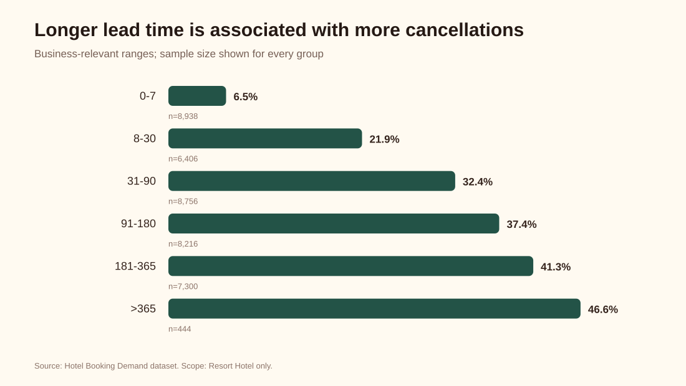
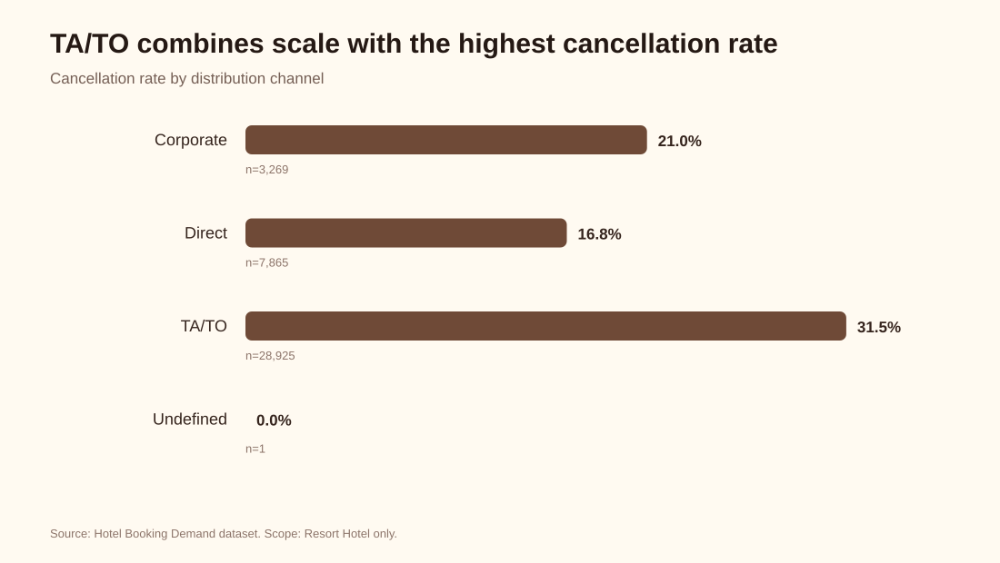
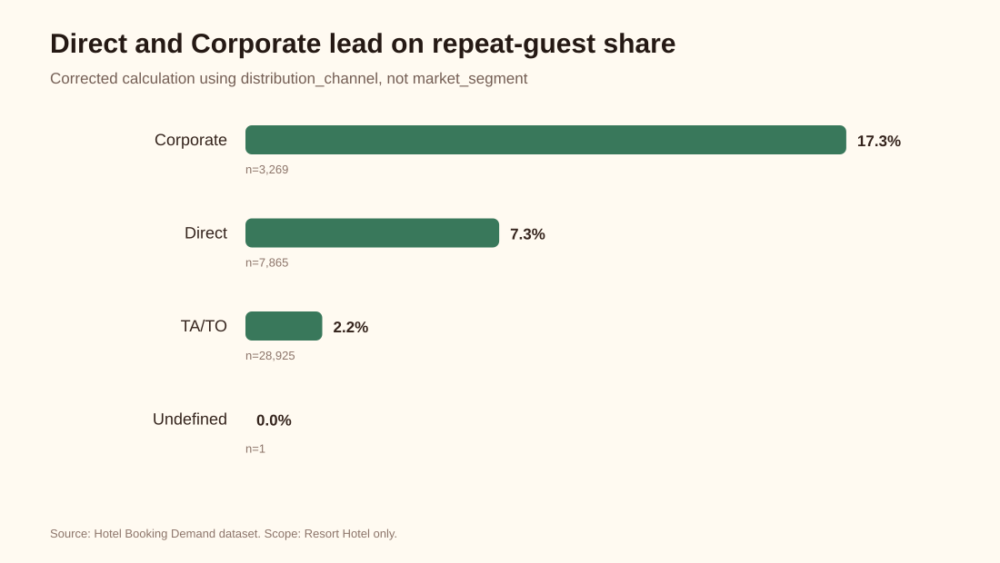

# Hotel Booking Demand: Reducing Resort Hotel Cancellations

An evidence-first personal refactor of a collaborative RevoU Data Analytics capstone. The project audits 40,060 Resort Hotel bookings from 2015-2017, corrects a field-mapping defect in the original workbook, and replaces a weak 589-day cutoff with reproducible, sample-size-aware analysis.

## Executive summary

- **27.76%** of Resort Hotel bookings were canceled (11,122 of 40,060).
- The rate increased from **25.72% in 2015** to **30.76% in 2017**.
- Cancellation rate rises from **6.52% for 0-7 days** lead time to **46.62% above 365 days**. This is an association, not proof of causality.
- **TA/TO** is the largest distribution channel and has the highest material channel cancellation rate at **31.49%**.
- **Transient** bookings represent the clearest high-risk customer segment at **31.17%** cancellation.
- The original repeated-guest chart referenced `market_segment` while labeling `distribution_channel`. The corrected output is included here.

| Segment | Bookings | Cancellation rate |
|---|---:|---:|
| Direct | 7,865 | 16.85% |
| Corporate | 3,269 | 21.05% |
| TA/TO | 28,925 | 31.49% |

## Recommendation framework

1. Test reminder, deposit, or flexible-rebooking treatments for long-lead-time Transient and TA/TO bookings.
2. Measure incremental cancellation reduction against a control group; do not treat historical association as causal proof.
3. Use a five-percentage-point reduction as a target only after power and cost-benefit calculations.
4. Track cancellation rate, net revenue, rebooking rate, customer complaints, and channel mix as guardrails.

## Team attribution

The source deck credits Team L, Group 23 (Jakarta): Rian Prasetyo, Dewi Sinta F., Ferdinand Rockwell S. S., Rachma Tantri A., Syaiful Mujib M., and Rani Anindya S. It identifies Rockwell as a Data Analysis PIC. The original artifacts and their contribution history remain the authoritative team record.

## Source artifacts audited

- Team deck: [Data Analytics Capstone Deck](https://drive.google.com/file/d/1uYdn62b8JxeRuaGyGA-rAHOcdhJATTWB/view)
- Team analysis sheet: [Backup Group 23](https://docs.google.com/spreadsheets/d/1vMMq3SIsPfG_y_OYnIEQaWMaRID6NlzKFaZQZ899_sE/edit)
- Team dashboard: [Group 23 Capstone](https://lookerstudio.google.com/reporting/672ec98b-8ad9-4503-867c-9e9edaad4379)
- Public dataset cited by the deck: [Hotel Booking Demand on Kaggle](https://www.kaggle.com/datasets/jessemostipak/hotel-booking-demand)

## Reproducible workflow

`analysis.py` uses only the Python standard library and outputs `metrics.json`. `build_report.py` converts verified metrics to dependency-free SVG charts. Tests protect Resort Hotel scoping, denominator logic, and the corrected distribution-channel calculation.

1. Download `hotel_bookings.csv` from the cited dataset.
2. Run `python analysis.py path/to/hotel_bookings.csv --output metrics.json`.
3. Run `python build_report.py`.
4. Run `python -m unittest discover -s tests`.

The raw dataset is intentionally not committed. Download it from the cited source and keep it as `data/hotel_bookings.csv` or pass any path to the script.

## Limitations

This is observational booking data with no stable customer identifier or experiment assignment. Results describe associations and should inform hypotheses, not causal claims. The original live Looker Studio report currently has broken data-source components; the version-controlled SVG charts in this repository are the verified portfolio output.

See [`AUDIT.md`](AUDIT.md) for the detailed formula review and limitations.
